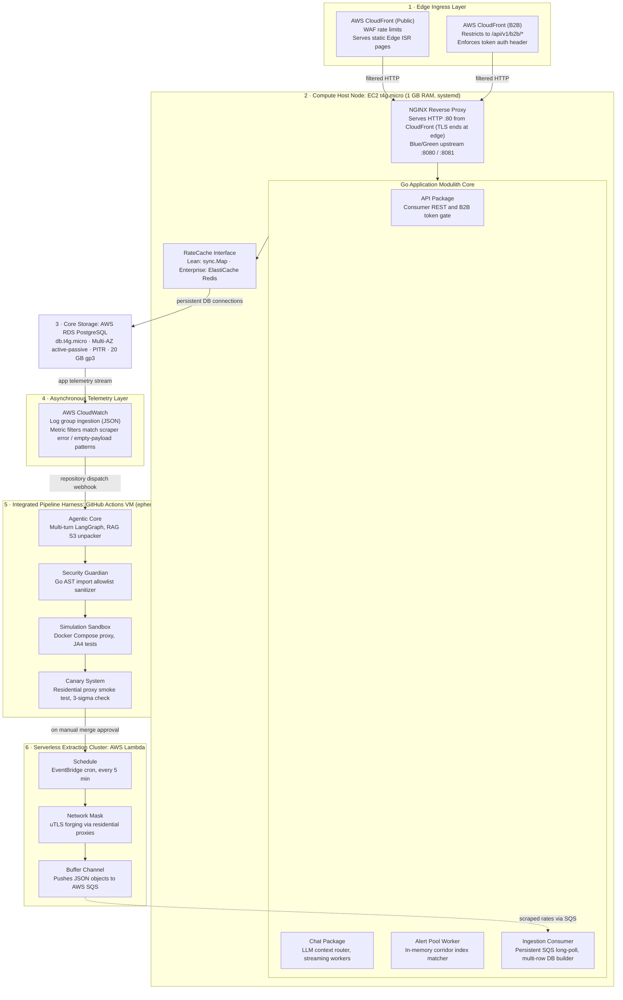
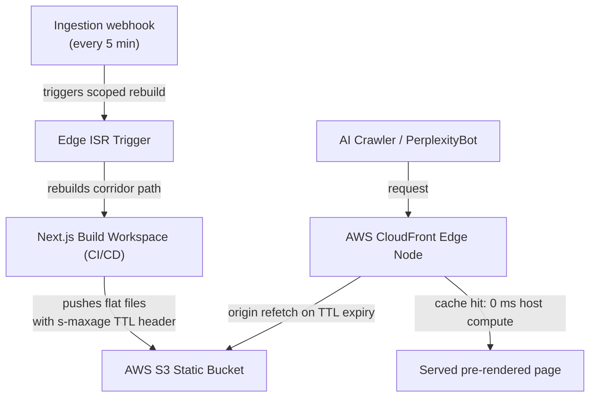
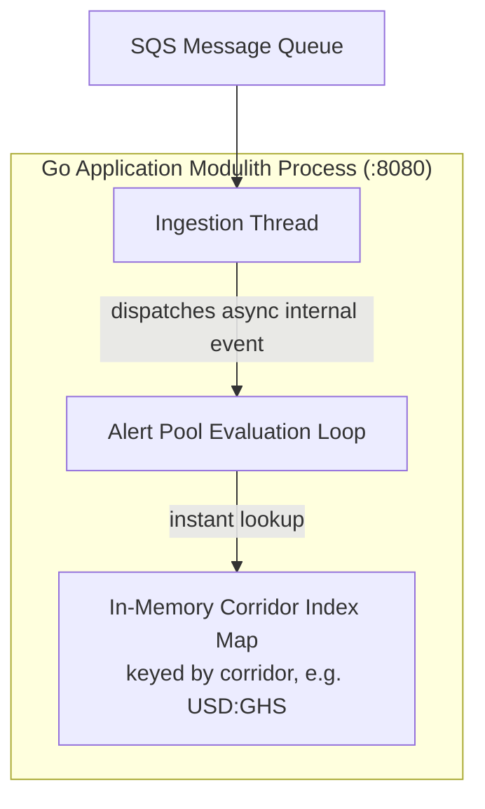
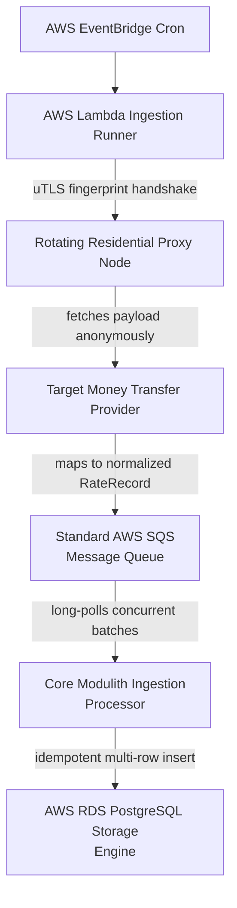
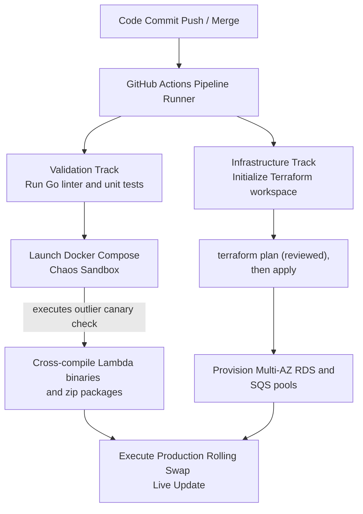
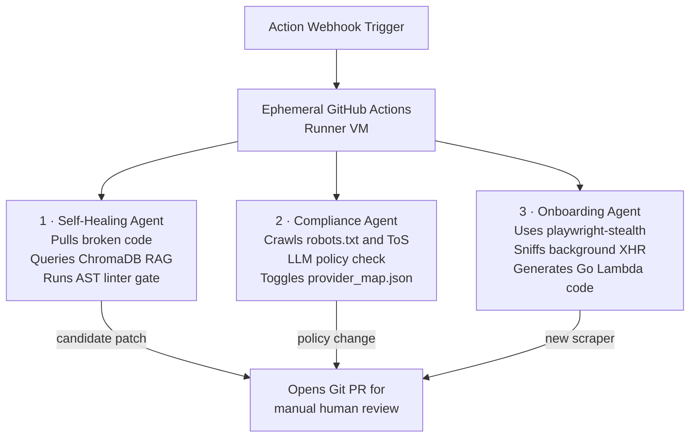
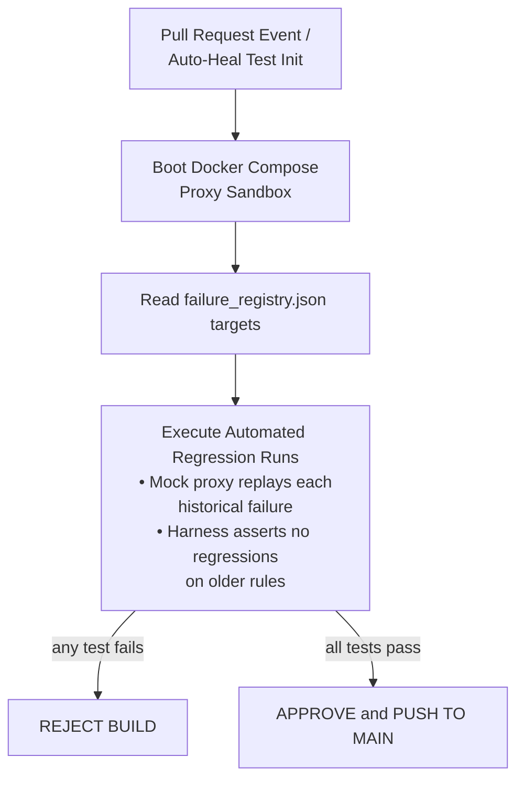

## RemitTrack: Technical System Architecture Design Document (SADD)
Target Phase: Production Blueprint (Hardened, Cost-Optimized)

Author: Oluwasegun Adewola

Last Updated: July 2026

------------------------------
## 1. Global System Topology
The global system topology isolates real-time data ingestion, public presentation caching, core business state management, and the agentic self-healing verification network into clean, decoupled tiers.


------------------------------
## 2. Component Deep Dives & Architectural Zoom-Ins
### Section A: Frontend, Ingress, & Programmatic Edge Caching
### Architectural Design & Implementation Blueprint
The public delivery architecture completely avoids hosting a live, resource-intensive Node.js JavaScript rendering process on the production machine. Instead, it shifts the computing weight outward to the Content Delivery Network (CDN) edge.


   1. **Static Build Ingestion Platform**: The frontend application package (`/frontend`) is developed using Next.js. During continuous delivery deployment steps, it compiles directly into flat, static HTML and asset arrays.

   2. **CDN Distribution Layer**: These pre-compiled pages are hosted inside an **AWS S3 Bucket** and distributed using **AWS CloudFront**. When an AI search engine, scraping bot (e.g., PerplexityBot), or standard user requests content, CloudFront resolves the connection directly from edge cache memory, ensuring **0 MB memory allocation** on your core host machine.

   3. **Edge Incremental Static Regeneration (ISR) Webhook Integration**: When the ingestion pipeline finishes compiling fresh pricing values (every 5 minutes), the background processor fires an authenticated webhook to a scoped rebuild step. This is a small, narrowly-triggered build job (a single build Lambda or a scoped CI job, not a full CI/CD pipeline run) that regenerates only the changed currency corridor's flat files (e.g., `/exchange-rates/gbp-to-ngn`) and writes them to the **S3 origin** with a short `Cache-Control: public, s-maxage=300, stale-while-revalidate=60` header. The freshness mechanism is TTL expiry, not invalidation: CloudFront serves the cached page for up to the `s-maxage` window (aligned to the 5-minute ingestion cadence), then refetches the newly-written object from S3 on the next request. We deliberately do **not** call the CloudFront Invalidation API on this per-tick path — at 288 rebuilds/day per corridor that would cost $0.005/path beyond the 1,000/month free tier (hundreds to thousands of dollars/month across corridors) for a freshness guarantee the TTL already provides. This pattern ensures web crawlers that bypass client-side JavaScript always receive pre-rendered metrics that are fresh within one cadence, at 0 MB host compute and $0 per-tick invalidation cost. (Invalidation is retained only for the rare frontend *deploy*, when the HTML template itself changes — see Section D.)

   4. **Structured Semantic Injections**: The static file generation layer maps data directly into rich JSON-LD data graphs. It injects `ExchangeRateSpecification` schemas for table rows and parses user intent queries from conversational logs into valid `FAQPage` structures, capturing organic long-tail search visibility.

   5. **Internationalization Execution Architecture (i18n)**: Next.js handles regional localized paths natively through directory layout structures: `/app/[locale]/exchange-rates/[corridor]/page.tsx`. It pulls strings from disk dictionaries (e.g., `/locales/fr.json`), and the build process automatically appends explicit canonical tags and hreflang cross-references into the HTML header:
        ```html
        <link rel="alternate" hreflang="en-gb" href="https://remittrack.com" />
        <link rel="alternate" hreflang="fr-fr" href="https://remittrack.com" />
        ```

   6. **Per-Route Rendering Strategy (crawlable vs. interactive)**: Rendering mode is chosen *per route* by a single question — **does a crawler need to see this content?** — never globally.
        * **Public corridor pages** (`/exchange-rates/[corridor]`) are the SEO/AI-citation surface and are **statically rendered with a real rate baked into the HTML**. This is non-negotiable: Googlebot only renders client-side JavaScript on a deferred, budget-limited second pass, and the AI crawlers this platform explicitly courts (PerplexityBot, GPTBot) do **not** execute JavaScript at all — a purely client-rendered page is blank to them, which forfeits both ranking and AI-engine citations.
        * **Logged-in and interactive surfaces** (alert management, the operator dashboard, the chat, the B2B console) are **not crawlable and do not need to be**. They are served as a normal client-rendered app that calls the cached JSON rates API directly — no static rebuild, no invalidation, no crawler concern. The simpler traditional client-server model is correct precisely where SEO is irrelevant.
        * **Static baseline + live client hydration** (the best-of-both default for corridor pages): each static page ships with a correct-as-of-last-rebuild rate in the HTML (what crawlers read, and the graceful fallback for a JavaScript-disabled client), plus a small client script that fetches the cached rates API to tick the number live for interactive humans. This deliberately **decouples two freshness requirements that need not be equal**: search and AI crawlers rank fine on rates fresh within the hour, while a human watching the page gets sub-minute updates from the API. The payoff: the static rebuild cadence can be relaxed (e.g., hourly rather than every 5 minutes), shrinking the edge/ISR pipeline, while real-time freshness comes from the same cached API that already backs the interactive surfaces.

### Product Engineering & Operational Configurations

* **WAF Layer Guard Rules**: Set up AWS WAF rules on CloudFront with custom rate limits. Block or puzzle-challenge IP addresses hitting `/api/v1/auth/*` or dynamic conversational endpoints more than 100 times within 5 minutes. Maintain a dedicated header override block to guarantee entry for verified search crawlers like Googlebot and PerplexityBot. CloudFront terminates user TLS at the edge; the origin (NGINX on port 80) is locked to CloudFront using an origin secret header plus AWS-managed CloudFront prefix lists, so the plain-HTTP origin hop is never publicly reachable.

### Architectural Trade-offs

* **Static Edge Generation over Live SSR Runtime**: Choosing edge-triggered static generation limits your ability to customize page components dynamically based on real-time user header variables (like local currency localization guessing via incoming IP data). However, it drops host operational server expenses down to zero and protects the compute engine from crash states during heavy web scraping sweeps. If true per-user rendering is ever required (currency localization by IP, logged-in state), that is the point to introduce SSR or a Lambda@Edge render tier; until then, paying per-request edge compute for pages identical to every viewer is the wrong trade.
* **TTL Expiry over Per-Tick Invalidation**: Relying on a short `s-maxage` TTL means a corridor page can be served up to roughly one ingestion cadence stale at a given edge (worst case slightly more, since an edge caches relative to its own first fetch), versus near-instant freshness if we invalidated on every rebuild. For SEO/crawler freshness and a 5-minute cadence this bounded staleness is immaterial, and every page carries a visible "last updated" timestamp. In exchange we eliminate a recurring invalidation bill that scales with corridors × rebuild frequency. If true instant freshness is ever required, the escalation is **versioned object keys plus a pointer** (write `rates.<epoch>.json`, then flip a small long-cached manifest), never a return to per-tick invalidation.
* **Static Baseline + Client Hydration over a Uniform Rebuild Cadence**: Baking a build-time rate into the crawlable HTML and freshening it client-side adds a small amount of frontend logic (a fetch plus a graceful no-JS fallback to the baked-in number). However, it lets crawler-facing freshness (hourly is ample for ranking and AI citation) and human-facing freshness (sub-minute via the cached API) be tuned **independently**, so the static rebuild pipeline can run far less often than the 5-minute ingestion cadence — cutting edge cost and complexity — without degrading the live experience. The baked-in rate doubles as the correct graceful degradation for JavaScript-disabled clients.

------------------------------
## Section B: Core Backend Modulith, In-Memory Alert Engine, & B2B Layer
### Architectural Design & Implementation Blueprint
The core application (`/backend`) is constructed inside a single Go compiled modulith binary package running under **Linux Systemd Process Supervision** on an **AWS EC2 `t4g.micro`** virtual node.


   1. **NGINX Upstream Rolling Swap Routing**: NGINX handles ingress data flows on the virtual host machine, shielding the Go execution process. It implements a dual-port upstream configuration matrix to support zero-downtime hot reloads:
        ```nginx
        # Deploy tooling rewrites this file to point at the newly-started colour,
        # then runs `sudo systemctl reload nginx`. Only one colour is ever active.
        upstream go_modulith_active {
            server 127.0.0.1:8080;   # active colour (blue); swapped to :8081 (green) on deploy
        }
        ```
   
        When the deployment pipeline transfers a new binary artifact onto the host, it starts the new process on the idle colour (say `8081`), health-checks it, rewrites the `upstream` block to point at `8081`, and triggers a safe configuration refresh: `sudo systemctl reload nginx`. NGINX spawns fresh worker threads that route new connections to `8081` while the old workers let in-flight transactions on `8080` drain gracefully, after which the retired process is stopped. This keeps the swap free of dropped requests.
   
   2. **In-Memory Worker Alert Pool Loop (durable rules, at-least-once delivery)**: The platform separates rate alert *evaluation* from the database read path for latency — but never at the cost of durability. The design draws a hard line between disposable compute and durable state:
        * **Rules are DB-sourced; the map is a rebuilt cache.** Every user alert (`AlertConfig`) is persisted in PostgreSQL as the single source of truth. On process start (and on any rule create/update/delete) the Modulith (re)builds an in-memory index, `map[string][]AlertConfig`, keyed by currency corridor (e.g., `"USD:GHS"`). Losing the process loses only the cache, which is fully reconstructable from the DB; **no user alert is ever lost to a restart or crash.** The map is a read accelerator, not a store of record.
        * **Evaluation is in memory.** When a fresh data batch completes ingestion, the worker pool looks up the affected corridor's slice in O(1) and evaluates each price target in memory, avoiding a read spike on the historical tables.
        * **Firing is edge-triggered and idempotent.** Each alert carries a persisted trigger state (`armed → triggered → armed`). A condition that *stays* crossed fires once, not on every 5-minute batch; the alert re-arms only after the rate resets past the threshold. This state lives in the DB, so it survives restarts.
        * **Delivery uses a transactional outbox, not a fire-and-forget email.** A DB commit and an SES call cannot be made atomic, so the design does not try. In the *same transaction* that flips an alert to `triggered`, it inserts a row into a `notifications` outbox table (`status = pending`). A separate dispatcher goroutine reads pending rows, calls **AWS SES (Simple Email Service)**, and marks them `sent`. A crash between "fired" and "sent" leaves the row `pending`, so it is retried on recovery, and a `notification_id` dedup key keeps a retry from double-sending. The failure mode is converted from *silently dropped notification* into *delivered slightly late (or, rarely, twice)* — the correct trade for an alert.

   3. **Stripe Webhook Idempotency Architecture**: The Stripe billing endpoint (`/api/v1/webhooks/stripe`) enforces crypto-signature verification using Stripe's Webhook Secret Key. To block duplicate transaction processing streams from network retry events, it passes payloads through an **Idempotency Execution Ledger** table inside PostgreSQL. The controller hashes the transaction token (`evt_id`); if a collision matches an existing hash, the pipeline discards the request before running business logic. A user's subscription **tier** is derived state from Stripe: the webhook updates a `users.tier` column that gates features (alert count, corridors accessible, B2B/API access, and the operator dashboard). Because a single missed webhook would silently desync billing entitlements, a periodic reconciliation job re-reads Stripe subscription status and corrects any drift.

   4. **B2B Token Verification Middleware Engine**: Corporate consumers pull real-time rates through an independent token-gated endpoint (`/api/v1/b2b/rates/latest`). The request passes through custom Go auth middleware that validates the provided `x-api-key` against hashed records inside PostgreSQL. Requests are rate-limited via a token-bucket algorithm hosted inside the instance memory space.

   5. **LLM Chat Interface (accessibility + FAQ source)**: A chat package inside the modulith answers plain-English rate questions, routing context to the configured LLM and streaming responses through worker goroutines. It is positioned as an accessibility feature for users who parse dense tables poorly, and its anonymized conversation logs are the input to the FAQ mining engine that publishes `FAQPage` schemas (Section A) for long-tail search capture.

   6. **Operator Market Intelligence Dashboard**: A read-only analytics surface for MTP operators (pricing trends, regional market share, arbitrage exposure), gated behind the B2B tier. To honor the hot-path rule that user queries never scan `historical_rates`, the dashboard reads from a periodically refreshed rollup (a materialized view or summary table), not live from the hot tables. (Scope note: confirm whether this ships in v1 or is deferred; the rollup source is the recommended default either way.)

   7. **Comparison Read Path, On-Demand Live Quoting & Default Resolver**: The consumer comparison is served from the hot `current_rates` table (one row per quote key) and **ranked by effective rate = `receive_amount / total_paid`** — a convention-agnostic, exact measure that collapses every fee model (additive, deducted, percentage, tiered) into one comparable number. Only `rate_class = 'standard'` rows are ranked; promotional classes (e.g. first-transfer) surface as a badge, never as the ranking price, so returning users are never shown a rate they cannot get.
        * **Benchmark-cached by default.** Quotes for a small set of benchmark send amounts are precomputed on the 5-minute ingestion tick and served from `current_rates`/cache. This powers the static SEO pages and the default table with zero live fan-out.
        * **On-demand live quoting for exact amounts.** When a user enters an amount with no cached benchmark, the Modulith fans out to the providers' quote endpoints **concurrently under an overall deadline**, returning whatever answered and marking the rest temporarily unavailable (partial results never block the page). Calls are **coalesced with single-flight** (many users asking the same corridor+amount trigger one upstream call) and cached with a short TTL (~30–120s), so repeat asks never re-hit the provider. Live quoting is reserved for providers exposing a clean partner/quote API; scrape-only providers stay benchmark-cached rather than being hammered live.
        * **Default resolver (what the landing page shows).** The sending country is inferred cheaply at the edge (`CloudFront-Viewer-Country`); the receiving corridor *cannot* be inferred from IP, so it defaults to the most popular destination for that sending country (seeded with known diaspora corridors, refined from aggregate usage) behind a prominent selector whose choice is remembered. The default send amount resolves most-specific-first: the user's last-used amount → the corridor's **median** requested amount (median, not mean, because remittance amounts are right-skewed) → a global fallback. The static page renders the population default (crawler-safe); client hydration personalizes it. The benchmark amount set is itself demand-shaped over time, so precomputed amounts converge on the amounts users actually request, shrinking live fan-out.

### Product Engineering & Operational Configurations

* **Systemd Configuration File (`/etc/systemd/system/remittrack.service`):**

    ```ini
    [Unit]
    Description=RemitTrack Go Modulith Core Engine
    After=network.target

    [Service]
    Type=simple
    User=ubuntu
    WorkingDirectory=/home/ubuntu/remittrack
    ExecStart=/home/ubuntu/remittrack/main
    Restart=always
    RestartSec=1s
    Environment=APP_ENV=production REMITTRACK_INFRA_PROFILE=LEAN
    StandardOutput=append:/var/log/remittrack/app.log
    StandardError=append:/var/log/remittrack/err.log

    [Install]
    WantedBy=multi-user.target
    ```

### Architectural Trade-offs

* **In-Memory Map Cache over Distributed Redis Infrastructure**: Running alert caches natively inside a Go `sync.Map` or local pointer allocation layer delivers incredibly low latency at zero cost. However, it binds your state memory to a single host computer footprint. If you expand the deployment cluster to support horizontal multi-node scaling across separate machines, this in-memory cache architecture must be refactored to use an external, shared distributed cache layer like **Amazon ElastiCache Redis**. The same `REMITTRACK_INFRA_PROFILE` switch that flips the cache also selects the compute topology: the LEAN profile is the single EC2 modulith, while the ENTERPRISE profile repoints CloudFront to an AWS Application Load Balancer fronting an autoscaling **AWS ECS Fargate** cluster of Go containers. Note the coupling this exposes: the in-memory alert pool assumes a single process, so the move to multi-node Fargate requires either relocating the alert pool behind ElastiCache or designating one node as the alerting owner. That decision must be made deliberately at scale-up time, not discovered during it.
* **Durability via DB + Outbox, Orthogonal to the Cache Choice**: The in-memory-vs-Redis decision above is purely a *latency-and-scaling* axis; it is deliberately decoupled from *durability*. Because alert rules and trigger state are persisted in PostgreSQL and notifications flow through a transactional outbox, neither a lost cache nor a crashed process can drop a user alert or a pending notification. This is what lets the alert pool stay in-memory for speed without accepting any data-loss risk: the two concerns are independent by design, so "in-memory" here never means "in-memory only."
* **Cached + Coalesced Live Quotes over Per-Request Fan-Out**: Quoting every provider live on every comparison would multiply one user request into 15+ outbound calls — latency bound to the slowest provider, provider rate-limit exposure, and per-call cost. Serving benchmarks from cache and reserving live fan-out for genuine cache misses (concurrent, deadline-bounded, single-flighted, short-TTL cached) keeps the common case at zero upstream calls while still delivering exact, amount-specific quotes on demand. The cost is a second (pull) ingestion path alongside the scheduled (push) one, and eventual — not instant — accuracy for a brand-new amount until its first live quote lands.

------------------------------
## Section C: Hardened Serverless Ingestion & Network Evasion Data Pipeline
### Architectural Design & Implementation Blueprint
The scraping and pipeline framework decouples data extraction completely from the host machine to isolate process threads and prevent connection exhaustion.


   1. **Stateless, API-First Serverless Extractor**: Extraction runs in standalone **AWS Lambda functions** (Go), scheduled every 5 minutes by AWS EventBridge. Each provider's entry in `provider_map.json` declares an ingestion strategy: the Lambda calls the provider's official partner API when a compliant endpoint exists, and only falls back to browser-emulating scraping when no compliant API is available or the API call fails. `provider_map.json` is the single source of truth for per-provider strategy and is read and written by the scrapers, the Compliance Sentinel, and the Onboarding Agent alike. API-first ingestion is more reliable and more clearly legal, and it reduces how often the self-healing pipeline must fire at all. Crucially, the target is a **quote endpoint** — the provider's own partner API, or the JSON endpoint behind its rate calculator — queried for a specific send amount and method, so the Lambda captures the provider's *own computed output* (receive amount, fees, offered rate) rather than reconstructing any fee formula. `provider_map.json` also carries per-provider and, where they differ, per-corridor pricing configuration (available pay-in/pay-out methods, and rate classes such as `standard` vs `promo_first_transfer`).

   2. **Network Evasion & Handshake Forging**: To bypass firewall systems (such as Cloudflare or Akamai), the scraping Lambdas implement the uTLS library (`github.com/refraction-networking/utls`) instead of Go's default `crypto/tls` module, allowing them to forge client TLS extension handshakes to look exactly like standard consumer browsers. The Lambda configuration routes all outbound connections through an external, encrypted **Rotating Residential Proxy Network Service** by setting the HTTP_PROXY shell variable, hiding data center IP signatures. This defeats JA4/JA4+ TLS fingerprinting; the client additionally mirrors browser HTTP/2 frame behavior (SETTINGS values, WINDOW_UPDATE cadence, and pseudo-header ordering) so the higher-layer fingerprint matches the forged TLS ClientHello rather than exposing a Go default.

   3. **The Standard SQS Buffering Infrastructure**: The Lambda normalizes each provider's response into a unified **RateRecord quote** at the edge — the *observed* output for a given `(corridor, send amount, pay-in, pay-out, rate class)`: send amount, total paid, receive amount, fees, and the offered rate, with money held as integer minor units (never floats) — then pushes the payload into a standard **AWS SQS Ingestion Queue** and instantly terminates. This decouples the scrapers from the database layer. Inside the core Go modulith on the EC2 host, a persistent background consumer thread long-polls the SQS queue, pooling rows into unified batches.

   4. **Idempotent Storage Ingestion Layer**: The Modulith writes quote batches to the **AWS RDS PostgreSQL** (`db.t4g.micro`) engine using an idempotent insert-or-ignore block. A quote is unique per provider + corridor + the inputs that change its price (send amount, pay-in/pay-out method, rate class) at a scrape instant:
        ```postgresql
        -- A quote is keyed by the inputs that change its price, not by corridor alone.
        -- scrape_timestamp is full-resolution so distinct fetches are never collapsed;
        -- DO NOTHING only discards true duplicate deliveries (SQS at-least-once).
        INSERT INTO historical_rates
            (provider, currency_pair, send_amount, total_paid, receive_amount, fees,
             offered_rate, pay_in, pay_out, rate_class, scrape_timestamp)
        VALUES ($1, $2, $3, $4, $5, $6, $7, $8, $9, $10, $11)
        ON CONFLICT
            (provider, currency_pair, send_amount, pay_in, pay_out, rate_class, scrape_timestamp)
            DO NOTHING;
        ```
        A separate `current_rates` table holding one row per quote key `(provider, currency_pair, send_amount, pay_in, pay_out, rate_class)` is updated on each successful insert and backs the comparison read path, ranked by effective rate (`receive_amount / total_paid`), so the growing `historical_rates` table is never scanned on hot user queries. All money columns are integer minor units.
   
   5. **Multi-AZ Availability Durability Profile**: The RDS instance is configured within an active-passive **AWS Multi-AZ Deployment Map**. Transaction logs stream continuously to an isolated secondary availability zone, providing automated failover routing, automated snapshot states, and Point-In-Time Recovery (PITR) protection.

### Product Engineering & Operational Configurations

* **Outbound Redirection Protection**: To secure affiliate links from open-redirect phishing exploitation, the internal redirection utility `/out/` checks incoming link addresses against a strict domain whitelist before returning a `302 Found` response:
    ```go
    var ApprovedProviders = map[string]string{
        "lemfi":    "https://example.com",
        "sendwave": "https://example.com",
    }
    ```


### Architectural Trade-offs

* **A Durable Queue over In-Process Channels**: Introducing an external queue at all (rather than piping scraped records straight into an in-process Go channel) adds a moving part and configuration. However, it gives the pipeline a durable, backpressured buffer: a burst of scraper output cannot exhaust the modulith's database connections, and nothing is lost if the consumer restarts mid-batch, because SQS holds and redelivers until the row is committed.
* **Standard SQS Ingestion over SQS FIFO Queues**: Switching from a FIFO queue to a standard SQS queue eliminates strict message delivery order sorting at the queue level. However, it removes throughput caps and simplifies scaling, while relying on idempotent SQL database constraints to safely handle out-of-order or duplicate message delivery streams.
* **Observe the Quote, Never Reconstruct the Fee Formula**: The pipeline stores the provider's *own* computed output (receive amount, fees, offered rate) for a specific input, rather than modeling each MTP's pricing algebra (fixed vs percentage vs tiered fees, promos, deducted-vs-additive fee conventions). Reconstructing formulas would be both fragile and dangerous — a wrongly computed price looks exactly like a correct one, the worst failure mode for a comparison product. Observing the realized quote makes accuracy the provider's responsibility and keeps our maintenance surface to a uniform set of quote-endpoint adapters (which the self-healing and onboarding agents already exist to keep alive).
* **Effective-Rate Ranking over Headline Offered Rate**: Ranking on `receive_amount / total_paid` rather than the advertised exchange rate prevents a provider with a great headline rate and a fat fixed fee from ranking first on a small transfer. It is exact (derived from observed inputs and outputs) and convention-agnostic, at the cost of requiring the pipeline to capture amounts and fees — not just a single rate — which is why the storage schema carries the full quote, not a lone `mid_rate`.

------------------------------
## Section D: DevOps, CI/CD, & Automated Infrastructure
### Architectural Design & Implementation Blueprint
The platform uses a complete GitOps model to manage deployment automation and cloud resource provisioning through a single GitHub monorepo configuration.


   1. **The Terraform Infrastructure Automation Engine**: The cloud footprint is fully managed as code within the `/infra/terraform/` repository directory. When modifications pass verification tests, continuous integration systems call the deployment toolchain:

        ```bash
        cd infra/terraform/envs/lean
        terraform init
        terraform plan -out=tfplan          # posted to the PR for human review
        # apply runs only after manual approval on the protected prod environment
        terraform apply tfplan
        ```

        This automatically manages access rights, configurations, and scaling parameters for components like your SQS message queues, Lambda runtimes, and multi-AZ RDS storage blocks. Stateful resources, the multi-AZ RDS instance above all, carry a `lifecycle { prevent_destroy = true }` guard so a bad plan can never replace or delete them, and the production `apply` is gated behind a manual approval rather than auto-approved.

   2. **Unified Continuous Integration Verification Engine**: When changes merge into the main application branch, a GitHub Actions runner boots up an ephemeral Ubuntu-latest workspace environment. The workflow executes all standard internal package validations: `go test -v ./...`.

   3. **Production Rolling Server Deployments**: If the global validation matrix returns full success checks, the runner cross-compiles the Go API Modulith core executable, packages the Lambda files into compressed zip folders, and ships the artifacts to AWS using the AWS CLI. It then securely connects to the EC2 host via SSH to reload NGINX and execute the zero-downtime rolling update process.

### Product Engineering & Operational Configurations

* **Terraform SQS Configuration Block (`infra/terraform/modules/messaging/main.tf`)**:
```hcl
resource "aws_sqs_queue" "remittrack_ingestion_queue" {
  name                      = "remittrack-rate-ingestion"
  delay_seconds             = 0
  max_message_size          = 262144
  message_retention_seconds = 86400
  receive_wait_time_seconds = 20 # Enables long-polling to minimize billing overhead

  lifecycle {
    prevent_destroy = true # applied to all stateful resources, RDS above all
  }
}
```

### Architectural Trade-offs

* **GitHub Actions Runners over Dedicated Cloud Testing Environments**: Offloading chaos tests and compilation suites entirely to GitHub Actions introduces workflow queue latency compared to running a dedicated cloud container node 24/7. However, it eliminates recurring testing infrastructure expenses, leveraging GitHub's free computation allotments to keep operational overhead at zero.

------------------------------
## Section E: AI Engineering & Multi-Agent Oversight
### Architectural Design & Implementation Blueprint
The AI Engineering layer operates within an isolated sandbox environment inside the GitHub Actions pipeline (`/services/`), running a multi-agent system designed to manage code healing, legal compliance tracking, and automated platform onboarding safely.

**Why this layer is core architecture, not a feature.** Provider markup and APIs change continuously; a fixed scraper set decays. For a rates comparison product the worst failure mode is silent, because a wrong number looks exactly like a right one. This layer is the mechanism that keeps data accurate for years without a human babysitting every provider: it detects decay, proposes a bounded fix, proves the fix breaks nothing historical, and gates every change behind a human. It is designed to be self-improving: every resolved failure is written back into the vector store and the failure registry, so the next occurrence of a similar break is faster to fix and permanently guarded by a regression test.

**The trust boundary (why autonomous code changes are safe).** No single failure or injected instruction can reach production, because every candidate patch climbs a ladder of independent gates, each of which can only reject:
1. **Scope restriction**: the agent may only edit JSON field-mapping transformers. A broken HTML DOM path is out of scope and escalates to a human immediately.
2. **AST allowlist gate**: generated Go is parsed by Go's own `go/parser`; anything importing outside the pure data-mapping allowlist, or using `//go:linkname`, is discarded before it ever compiles.
3. **Chaos sandbox**: the patch runs only inside an isolated Docker Compose mock-provider network, never against production.
4. **Statistical canary**: the produced rate must fall inside the 3-sigma historical window and the provider-calibrated cross-provider corridor.
5. **Regression corpus**: the patch must keep every historical failure case green (see Section 3).
6. **Mandatory human PR**: nothing merges without human sign-off.

Presented as a ladder, the safety argument is explicit: autonomy is bounded on six independent axes, and the blast radius of any compromised input is a rejected pull request, not a production change.



#### 1. The Agentic Self-Healing Engine (Python + LangGraph)
When an active data extraction pipeline triggers an execution crash or empty JSON data array, an AWS alarm hits the GitHub workflow interface via an authenticated repository dispatch webhook.

* **The Context Execution Step**: The runner downloads the compressed vector memory workspace archive (`chroma_db.tar.gz`) from an isolated AWS S3 Bucket into local storage (`/tmp/chroma_db`) and initializes an in-memory client session using `chromadb.PersistentClient`. The agent runs semantic search queries across historical logs to retrieve the top 3 code patches that successfully resolved similar error profiles.

* **The AST Whitelist Linter Security Gate**: Code candidate modifications generated by the configured code-generation LLM (the model is configurable via `services/shared` and intentionally not pinned in this document) are parsed by a dedicated Go AST validator (Go's `go/parser` package, invoked as a subprocess by the Python agent) before compilation to block remote code execution (RCE) vulnerabilities. The linter enforces a strict import allowlist: **anything not on the allowlist of pure data-mapping packages (`strings`, `strconv`, `encoding/json`, `errors`) is instantly discarded, and `//go:linkname` compiler directives are rejected outright**. The engine's scope is strictly restricted to updating JSON field-mapping dictionary keys. If a legacy HTML DOM page structure fails, the agent stops and alerts a human engineer.
* **The Statistical Canary Cross-Validation Gate**: If the code compiles safely, it runs inside the localized Docker Compose simulation proxy network. If simulation checks pass, the runner performs a **Live Internet Smoke Test** across a residential proxy. The extracted rate payload must pass a statistical evaluation before deployment approval:

$$\text{Pass Constraint} = \mu - 3\sigma \le \text{Candidate Rate} \le \mu + 3\sigma$$

* The rate must also align with an adaptive, provider-calibrated variance corridor compared to the other active platforms to catch data correctness or inversion errors. For a brand-new provider or corridor with insufficient history to compute a stable mean and standard deviation, the Z-score check is skipped and the candidate is held for mandatory human review rather than auto-passed. The engine attempts at most **three repair loops** per failure; if no candidate clears every gate within three attempts, it stops and escalates to a human rather than looping indefinitely. If all validation criteria pass, the system logs the entry to the registry and **opens a Git Pull Request for manual human engineering review**.

#### 2. The Compliance Sentinel Agent
This agent runs daily via a GitHub Actions cron schedule. It downloads and parses the `robots.txt` and Terms of Service (ToS) files for all 15+ monitored platforms, saving historical snapshots in an S3 bucket as an audit trail. The agent calculates a SHA256 checksum against yesterday's copy. If a change is detected, an LLM evaluates the updated text. If it uncovers new scraping restrictions, the agent automatically opens a Git Pull Request to update `provider_map.json` and deactivate that scraper function in production.

#### 3. The Automated Onboarding Agent
Triggered via an input command (`make onboard URL=...`), this agent first checks the url parameters against the Compliance Sentinel rules engine. If compliant, it launches a headless browser session inside GitHub Actions using `playwright-stealth` to bypass automated traffic filters. Playwright binds an event listener to the browser's virtual network interface and records background traffic for 45 seconds. It filters responses using regex expressions like `.*(rate|exchange|pricing).*`. If it captures an internal JSON response containing currency data, it maps the structure and prompts the LLM to write a brand new Go-based Lambda scraping function, opening a pull request for manual merge.

### Product Engineering & Operational Configurations
* **Go AST Linter Component** `(/services/agent_healer/linter.go)`. The Python LangGraph agent shells out to this Go validator, because Go source can only be parsed by Go's own `go/parser`, not Python's `ast`:
```go
// Validates an LLM-generated Go patch using Go's own AST parser.
// Enforces a strict import ALLOWLIST: anything not explicitly permitted is rejected.
package main

import (
    "errors"
    "fmt"
    "go/parser"
    "go/token"
    "strconv"
    "strings"
)

// Only pure data-mapping libraries are permitted. Everything else is rejected.
var allowedImports = map[string]bool{
    "strings":       true,
    "strconv":       true,
    "encoding/json": true,
    "errors":        true,
}

func VerifyASTSafety(goSource string) error {
    // Reject compiler directives that reach runtime symbols without an import.
    if strings.Contains(goSource, "//go:linkname") {
        return errors.New("security alert: //go:linkname directive is not permitted")
    }
    fset := token.NewFileSet()
    file, err := parser.ParseFile(fset, "patch.go", goSource, parser.ImportsOnly)
    if err != nil {
        return fmt.Errorf("patch rejected: unparseable Go source: %w", err)
    }
    for _, imp := range file.Imports {
        path, _ := strconv.Unquote(imp.Path.Value)
        if !allowedImports[path] {
            return fmt.Errorf("security alert: forbidden import %q (not on allowlist)", path)
        }
    }
    return nil
}
```

### Architectural Trade-offs

* **Strict AST Code Generation Restrictions over Broad Agent Autonomy**: Restricting your automated code repair engine to basic JSON mapping updates prevents it from fixing structural HTML changes on legacy platforms. However, as one defense-in-depth layer ahead of the mandatory human merge, it materially reduces the attack surface against compiler bypass vectors like `//go:linkname` and resource-exhaustion loops.

------------------------------
## 3. Runtime Verification & Failure Registries
To track pipeline health and maintain high data accuracy across all currency corridors, the system records and verifies every automation event using a strict logging and testing matrix.

### The System Log Ledger Schema (`failure_registry.json`)
Every automated execution step, simulation check pass, and canary validation event is logged directly inside an **AWS S3 JSON Analytics Registry** file for regression verification tracking:

```json
{
  "case_id": "ERR-LEMFI-JSON-073",
  "timestamp": 1783635600,
  "provider": "LemFi",
  "error_profile": "KeyError: 'mid_market_rate_value' payload layout missing",
  "agent_execution_metrics": {
    "turns_attempted": 2,
    "tokens_consumed": 4350,
    "ast_linter_checks": "PASSED"
  },
  "validation_canary_telemetry": {
    "historical_z_score": 0.42,
    "cross_provider_variance_delta": "0.012",
    "canary_exit_status": "VERIFIED_SUCCESSFUL"
  },
  "patch_output_artifact_s3": "s3://remittrack-artifacts/patches/lemfi_fix_073.go"
}
```

### Continuous Integration Regression Testing Sequence
When a new code change or onboarding integration request drops into the monorepo branch, the global evaluation test suite runs automated validation checks to prevent regressions before deployment:


By verifying your entire historical failure log array against every code candidate inside an isolated, containerized local loop, you protect production pipelines from breaking changes. This ensures high data reliability, solidifies security perimeters, and provides an exceptionally robust system architecture.

### The Failure Registry as a Living Test Corpus
`failure_registry.json` is not only an audit log; it is the regression test corpus that makes the platform harden with every incident. The lifecycle for any production failure is fixed:

   1. **Capture**: the failing provider payload and error profile are recorded as a new registry case.
   2. **Replay test**: a test is written that replays that exact payload through the pipeline.
   3. **Fix under constraint**: the candidate patch must make the new case pass AND keep every existing case green.
   4. **Permanence**: the replay test lives in CI forever.

The chaos environment is a Docker Compose network of mock provider endpoints that can serve any historical payload shape on demand, including the broken ones, so candidates are validated against the full history offline with zero production traffic. The governing invariant: **no candidate merges unless the entire historical failure corpus replays green.**

### Build-Order Principle for the Agentic and Chaos Layers
Because these gates are what make autonomous change safe, they must exist before the thing that generates code. The correct build order is:

   1. **Observability first**: structured error / empty-payload emission, the CloudWatch metric filter, and the repository-dispatch webhook. You cannot heal what you cannot detect.
   2. **Corpus and sandbox next**: the failure registry and the chaos replay harness, so there is a safe place and a standard against which to test.
   3. **Standalone gates**: the AST security gate and the statistical canary, each built and unit-tested in isolation with allowed/forbidden fixtures.
   4. **Then the generator**: the RAG + LLM self-healing engine, which can only open a PR.
   5. **Then Compliance Sentinel**, then the **Onboarding Agent last**, since it generates entirely new scrapers and carries the highest blast radius.

The principle in one line: **guardrails and corpus precede code generation, never the reverse.** The implementation plan's phase order encodes exactly this sequence.

